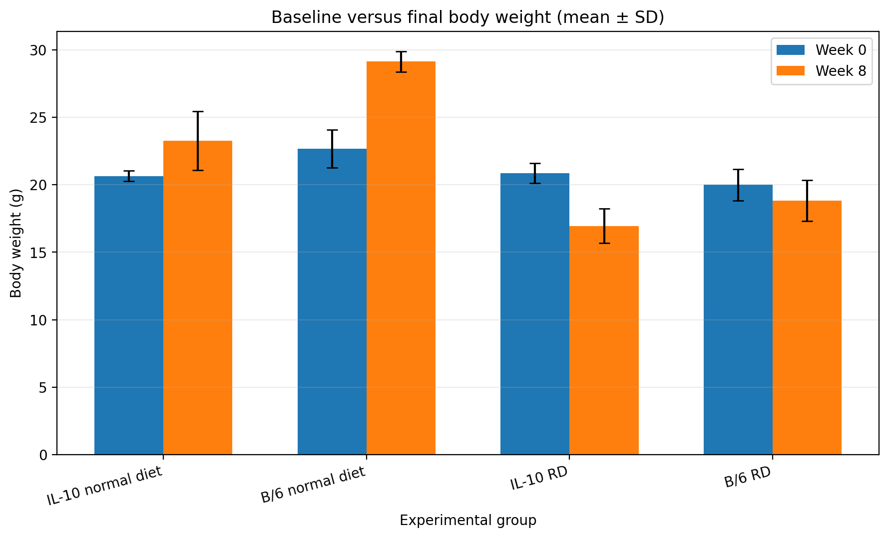
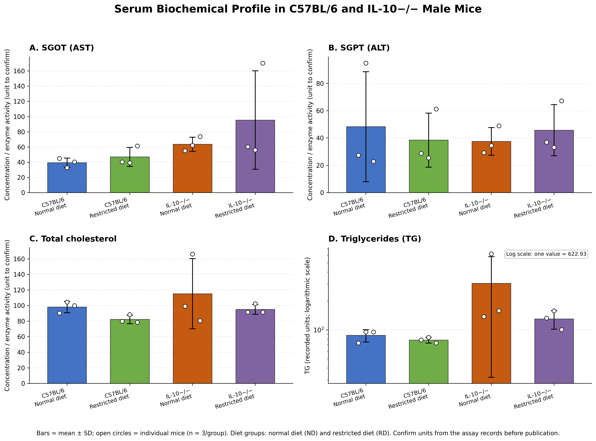
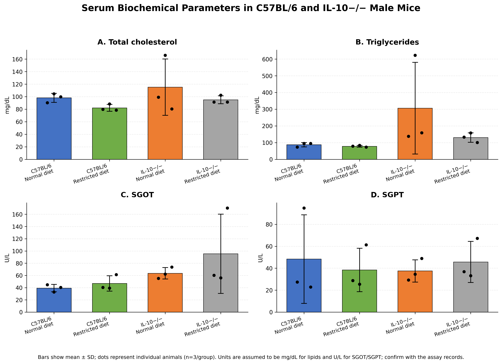
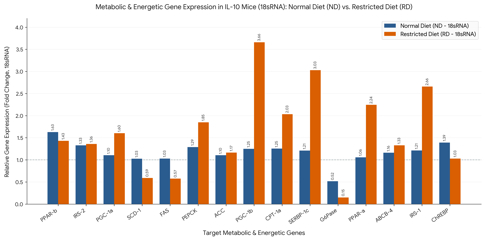
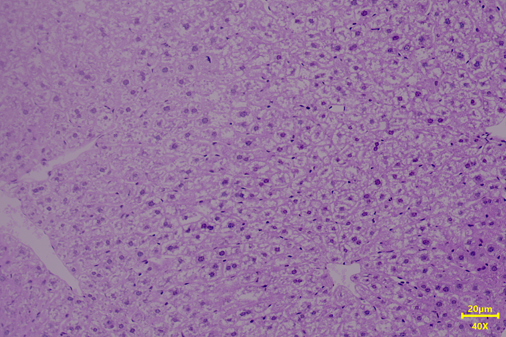
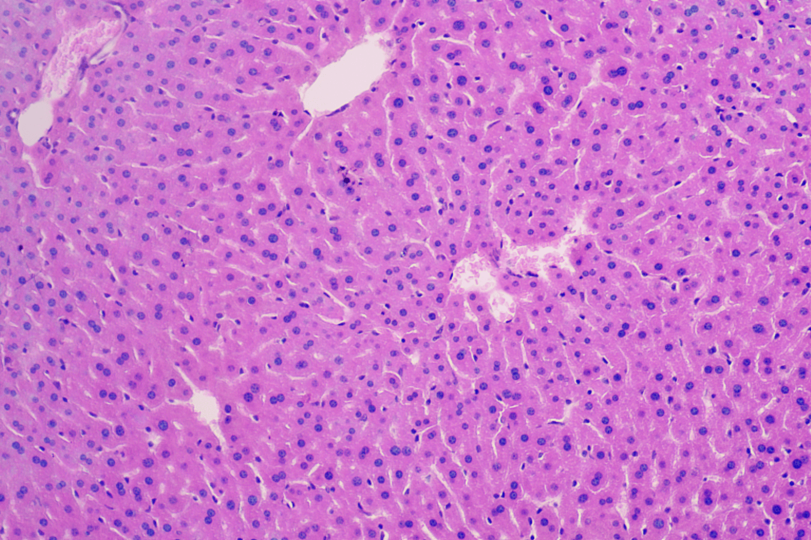
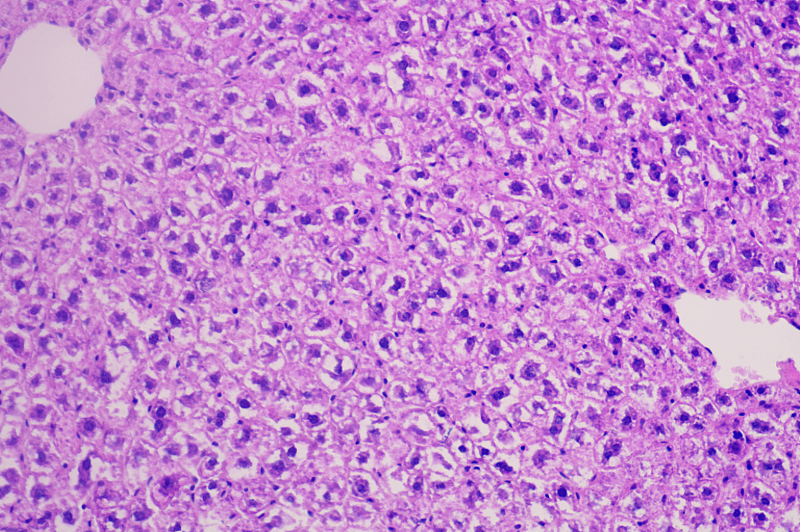
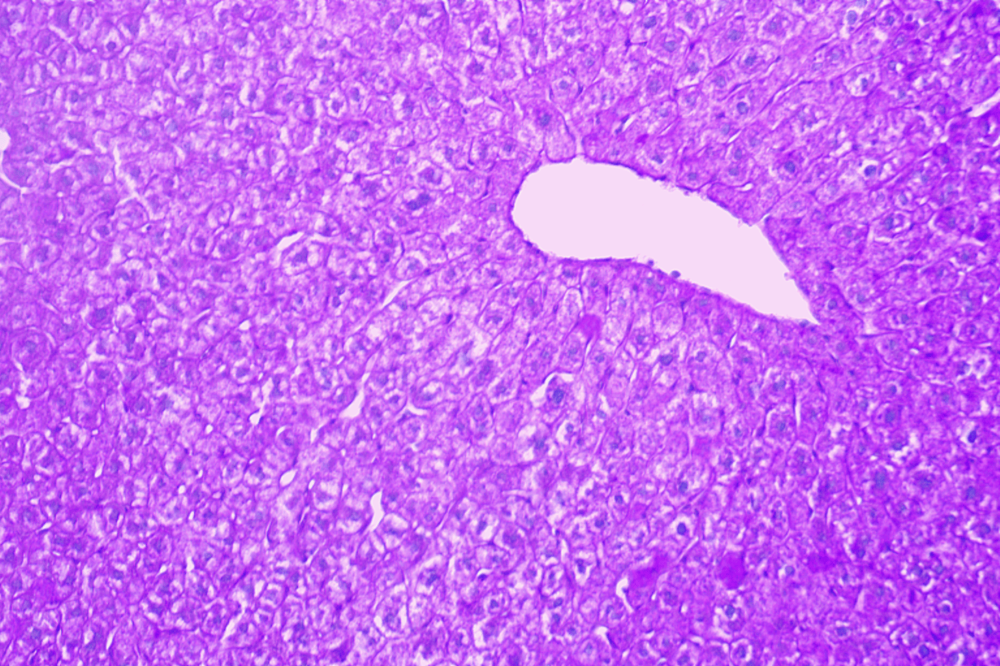
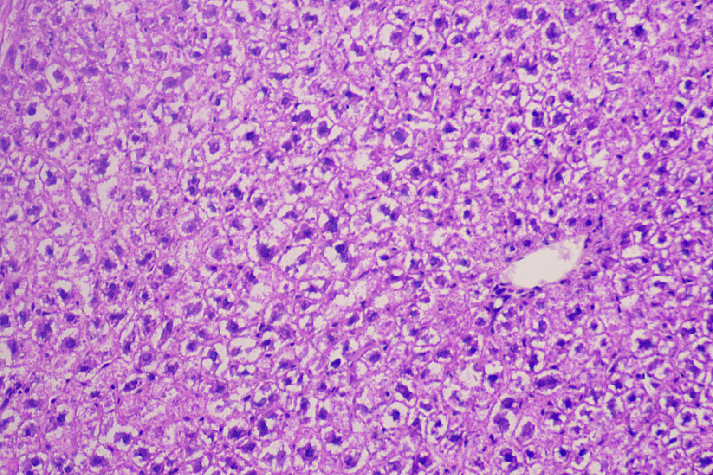

# Comparative Investigation of Hepatic and Colonic Responses to Prolonged Dietary Restriction in IL-10-Deficient and C57BL/6 Mice

---

## 📌 Project Overview

This research project investigates the physiological, metabolic, inflammatory, and histopathological responses to prolonged dietary restriction in two mouse models: **C57BL/6** and **interleukin-10-deficient (IL-10⁻/⁻)** mice.

Dietary restriction alters nutrient availability and energy metabolism, whereas IL-10 deficiency compromises an important anti-inflammatory regulatory mechanism. Studying these conditions together provides an opportunity to understand how nutritional stress influences hepatic metabolism and tissue responses in animals with different inflammatory backgrounds.

The study primarily focuses on hepatic responses, with additional investigation of colonic tissue and the potential relationship between intestinal inflammation and liver metabolism through the **gut–liver axis**.

## 🎯 Aim of the Study

> To comparatively investigate the effects of prolonged dietary restriction on metabolic regulation, inflammatory responses, and tissue architecture in C57BL/6 and IL-10-deficient mice.

---

## 🔬 Experimental Design

<h2 align="center">EXPERIMENTAL DESIGN AND ANIMAL MODELS</h2>

<table width="100%">
  <thead>
    <tr>
      <th width="20%">PARAMETER</th>
      <th width="30%">DETAILS</th>
      <th width="20%">PARAMETER</th>
      <th width="30%">DETAILS</th>
    </tr>
  </thead>
  <tbody>
    <tr>
      <td><b>Animal Models</b></td>
      <td>C57BL/6 and IL-10⁻/⁻ mice</td>
      <td><b>Sex</b></td>
      <td>Male</td>
    </tr>
    <tr>
      <td><b>Duration</b></td>
      <td>60 days</td>
      <td><b>Diet</b></td>
      <td>Altromin 1314, 5% fat</td>
    </tr>
    <tr>
      <td><b>Restricted Intake</b></td>
      <td>2 g/mouse/day</td>
      <td><b>Animal Facility</b></td>
      <td>National Institute of Immunology (NII), New Delhi</td>
    </tr>
    <tr>
      <td><b>Reference Condition</b></td>
      <td>Normal Diet (ND)</td>
      <td><b>Intervention</b></td>
      <td>Restricted Diet (RD)</td>
    </tr>
  </tbody>
</table>

<h3 align="center">EXPERIMENTAL GROUPS</h3>

<table width="100%">
  <thead>
    <tr>
      <th width="25%">GROUP I</th>
      <th width="25%">GROUP II</th>
      <th width="25%">GROUP III</th>
      <th width="25%">GROUP IV</th>
    </tr>
  </thead>
  <tbody>
    <tr>
      <td align="center">
        <b>C57BL/6 – ND</b> 
        Normal Diet
      </td>
      <td align="center">
        <b>C57BL/6 – RD</b> 
        Restricted Diet
      </td>
      <td align="center">
        <b>IL-10⁻/⁻ – ND</b> 
        Normal Diet
      </td>
      <td align="center">
        <b>IL-10⁻/⁻ – RD</b> 
        Restricted Diet
      </td>
    </tr>
  </tbody>
</table>

<h2 align="center">📊 PRELIMINARY RESEARCH FINDINGS</h2>

<h3>1. Body Weight Changes</h3>

Body weight measurements demonstrated different responses between
normal-diet (ND) and restricted-diet (RD) animals over the experimental period.

<table width="100%">
  <thead>
    <tr>
      <th width="25%">EXPERIMENTAL GROUP</th>
      <th width="25%">INITIAL WEIGHT</th>
      <th width="25%">FINAL WEIGHT</th>
      <th width="25%">BODY WEIGHT CHANGE</th>
    </tr>
  </thead>
  <tbody>
    <tr>
      <td><b>IL-10 ND</b></td>
      <td align="center">20.65 g</td>
      <td align="center">23.27 g</td>
      <td align="center">+12.66%</td>
    </tr>
    <tr>
      <td><b>B/6 ND</b></td>
      <td align="center">22.68 g</td>
      <td align="center">29.14 g</td>
      <td align="center">+28.43%</td>
    </tr>
    <tr>
      <td><b>IL-10 RD</b></td>
      <td align="center">20.86 g</td>
      <td align="center">16.95 g</td>
      <td align="center">-18.72%</td>
    </tr>
    <tr>
      <td><b>B/6 RD</b></td>
      <td align="center">20.00 g</td>
      <td align="center">18.82 g</td>
      <td align="center">-5.88%</td>
    </tr>
  </tbody>
</table>

<h3 align="center">BODY WEIGHT ANALYSIS</h3>

<table width="100%">
  <tr>
    <td align="center" width="50%">
      <b>Total Body Weight Change</b>  
      
    </td>
    <td align="center" width="50%">
      <b>Initial vs Final Body Weight</b>  
      
    </td>
  </tr>
</table>

<b>Observation:</b> Both restricted-diet groups showed a reduction in mean
body weight. The reduction was greater in IL-10-deficient mice (-18.72%)
than in C57BL/6 mice (-5.88%). In contrast, both normal-diet groups
showed an increase in mean body weight.

---

<h2>2. Serum Biochemical Profile</h2>

Preliminary serum biochemical results are presented as mean values
(n = 3 per experimental group). The analysis includes SGOT (AST),
SGPT (ALT), total cholesterol, and triglycerides.

<table width="100%">
  <thead>
    <tr>
      <th width="25%">BIOCHEMICAL PARAMETER</th>
      <th width="18.75%">B/6 ND</th>
      <th width="18.75%">B/6 RD</th>
      <th width="18.75%">IL-10 ND</th>
      <th width="18.75%">IL-10 RD</th>
    </tr>
  </thead>
  <tbody>
    <tr>
      <td><b>SGOT (AST)</b></td>
      <td align="center">39.27</td>
      <td align="center">46.96</td>
      <td align="center">63.58</td>
      <td align="center">95.47</td>
    </tr>
    <tr>
      <td><b>SGPT (ALT)</b></td>
      <td align="center">48.34</td>
      <td align="center">38.46</td>
      <td align="center">37.52</td>
      <td align="center">45.73</td>
    </tr>
    <tr>
      <td><b>Total Cholesterol</b></td>
      <td align="center">98.22</td>
      <td align="center">82.22</td>
      <td align="center">115.25</td>
      <td align="center">95.07</td>
    </tr>
    <tr>
      <td><b>Triglycerides</b></td>
      <td align="center">87.78</td>
      <td align="center">78.38</td>
      <td align="center">306.40</td>
      <td align="center">130.49</td>
    </tr>
  </tbody>
</table>

<h3 align="center">SERUM BIOCHEMICAL ANALYSIS</h3>

<table width="100%">
  <tr>
    <td width="50%" align="center">
      <b>Graph 1 – Serum Biochemical Profile</b>  
      
    </td>
    <td width="50%" align="center">
      <b>Graph 2 – Serum Biochemical Comparison</b>  
      
    </td>
  </tr>
</table>

<h3>Preliminary Observations</h3>

<ul>
  <li>Mean total cholesterol decreased under dietary restriction in both genotypes.</li>
  <li>Mean triglyceride concentrations also decreased in both genotypes.</li>
  <li>Mean SGOT (AST) increased in both restricted-diet groups.</li>
  <li>Mean SGPT (ALT) decreased in C57BL/6 mice but increased in IL-10-deficient mice.</li>
</ul>

<i>Note: Values are preliminary means (n = 3 per group).
Measurement units should be confirmed from the original laboratory records.
These comparisons are descriptive and do not establish statistical significance.</i>

---

<h2>3. Metabolic Markers &amp; Gene Expression Analysis</h2>

Gene-expression analysis was performed to compare metabolic responses
between Normal Diet (ND) and Restricted Diet (RD) conditions in
C57BL/6 and IL-10-deficient mice.

<h3 align="center">COMPARATIVE GENE EXPRESSION ANALYSIS</h3>

<table width="100%">
  <tr>
    <td width="50%" align="center">
      <b>C57BL/6: Normal Diet vs Restricted Diet</b>  
      
    </td>
    <td width="50%" align="center">
      <b>IL-10-deficient: Normal Diet vs Restricted Diet</b>  
      
    </td>
  </tr>
</table>

<h3>Comparative Observations</h3>

<b>C57BL/6 Mice:</b> Dietary restriction was associated with increased
PPAR-β expression and reduced expression of several metabolic genes,
including FAS, SCD-1, ACC, PEPCK, PGC-1α and PGC-1β. These changes
suggest alterations in lipid synthesis, glucose metabolism and
mitochondrial regulatory pathways.

<b>IL-10-deficient Mice:</b> Under dietary restriction, changes were
observed in genes associated with lipid metabolism, mitochondrial
function and insulin signalling. These included reduced FAS and SCD-1
expression, alongside changes in CPT-1α, PPAR-α, PGC-1α, PGC-1β and
IRS-1 expression.

<h3>Overall Interpretation</h3>

Dietary restriction was associated with genotype-dependent changes
in metabolic gene expression. Both mouse models showed alterations
in genes involved in lipid synthesis, while differences in mitochondrial
regulatory and insulin-signalling markers suggest distinct metabolic
responses to restricted food intake.

<i>Note: Gene-expression findings are descriptive. Changes in mRNA
expression do not independently establish corresponding changes
in protein abundance, enzyme activity or metabolic flux. Statistical
significance should be reported only after appropriate analysis
of biological replicates.</i>

---

<h2>4. Liver Histopathological Analysis (H&amp;E and PAS Staining)</h2>

H&amp;E and PAS staining were performed to examine liver tissue
architecture, cellular morphology, and carbohydrate-associated
staining patterns in C57BL/6 and IL-10-deficient mice under
Normal Diet (ND) and Restricted Diet (RD) conditions.

<h3>4.1 C57BL/6 Mice</h3>

<table width="100%">
  <tr>
    <th width="50%" align="center">H&amp;E STAINING</th>
    <th width="50%" align="center">PAS STAINING</th>
  </tr>
  <tr>
    <td align="center"><b>Normal Diet (B/6-ND)</b></td>
    <td align="center"><b>Normal Diet (B/6-ND)</b></td>
  </tr>
  <tr>
    <td align="center">
      
    </td>
    <td align="center">
      
    </td>
  </tr>
  <tr>
    <td align="center"><b>Restricted Diet (B/6-RD)</b></td>
    <td align="center"><b>Restricted Diet (B/6-RD)</b></td>
  </tr>
  <tr>
    <td align="center">
      
    </td>
    <td align="center">
      
    </td>
  </tr>
</table>

<b>Preliminary observations – C57BL/6:</b>
The H&amp;E sections can be compared for differences in hepatocyte
morphology, cytoplasmic appearance and tissue architecture between
ND and RD groups. PAS staining provides an indication of
carbohydrate-associated material, including glycogen, within
the liver tissue. Differences in PAS staining intensity should be
interpreted cautiously and ideally supported by quantitative analysis
or PAS-diastase controls.

<h3>4.2 IL-10-Deficient Mice</h3>

<table width="100%">
  <tr>
    <th width="50%" align="center">H&amp;E STAINING</th>
    <th width="50%" align="center">PAS STAINING</th>
  </tr>
  <tr>
    <td align="center"><b>Normal Diet (IL-10-ND)</b></td>
    <td align="center"><b>Normal Diet (IL-10-ND)</b></td>
  </tr>
  <tr>
    <td align="center">
      
    </td>
    <td align="center">
      
    </td>
  </tr>
  <tr>
    <td align="center"><b>Restricted Diet (IL-10-RD)</b></td>
    <td align="center"><b>Restricted Diet (IL-10-RD)</b></td>
  </tr>
  <tr>
    <td align="center">
      
    </td>
    <td align="center">
      
    </td>
  </tr>
</table>

<b>Preliminary observations – IL-10-deficient mice:</b>
The H&amp;E sections should be examined for differences in hepatocyte
morphology and cytoplasmic appearance between ND and RD conditions.
The PAS sections can be compared for changes in staining distribution
and intensity, which may reflect differences in carbohydrate-associated
material. These observations require confirmation through appropriate
histological assessment and quantitative analysis.

<h3>Overall Histopathological Interpretation</h3>

The H&amp;E and PAS staining approaches provide complementary
information about liver tissue morphology and carbohydrate-associated
staining patterns. Comparing both genotypes under ND and RD
conditions may help identify differences in hepatic responses
to prolonged dietary restriction.

<i>Note: Representative histological images provide qualitative
observations. They do not independently establish glycogen depletion,
hepatocyte injury or a specific pathological diagnosis. PAS-diastase
controls and blinded histological scoring would strengthen these
interpretations.</i>

---

<h2>5. Scientific Significance</h2>

This research explores the interaction between prolonged dietary
restriction and impaired anti-inflammatory regulation using
C57BL/6 and IL-10-deficient mouse models. By comparing normal and
restricted dietary conditions, the study provides insights into
genotype-dependent metabolic and hepatic responses to nutritional stress.

<ul>
  <li>Nutritional stress and hepatic metabolic adaptation.</li>
  <li>IL-10 deficiency and inflammatory regulation.</li>
  <li>Changes in circulating lipid-associated biochemical parameters.</li>
  <li>Hepatic tissue architecture under prolonged dietary restriction.</li>
  <li>Potential interactions between intestinal inflammation and hepatic responses.</li>
</ul>

<h2>6. Techniques and Skills</h2>

<table width="100%">
  <tr>
    <th width="25%">EXPERIMENTAL BIOLOGY</th>
    <th width="25%">MOLECULAR BIOLOGY</th>
    <th width="25%">HISTOLOGY</th>
    <th width="25%">DATA ANALYSIS</th>
  </tr>
  <tr>
    <td valign="top">
      <ul>
        <li>Laboratory animal research</li>
        <li>Tissue collection and processing</li>
        <li>Serum separation</li>
        <li>Biochemical analysis</li>
      </ul>
    </td>
    <td valign="top">
      <ul>
        <li>RNA extraction</li>
        <li>cDNA synthesis</li>
        <li>RT-qPCR</li>
        <li>Gene expression analysis</li>
      </ul>
    </td>
    <td valign="top">
      <ul>
        <li>Paraffin embedding</li>
        <li>Microtome sectioning</li>
        <li>H&amp;E staining</li>
        <li>PAS staining</li>
        <li>Immunohistochemistry</li>
      </ul>
    </td>
    <td valign="top">
      <ul>
        <li>Experimental data organization</li>
        <li>Growth curve analysis</li>
        <li>Biochemical visualization</li>
        <li>Comparative interpretation</li>
        <li>Scientific literature review</li>
      </ul>
    </td>
  </tr>
</table>

<h2>7. Conclusion</h2>

This study provides a comparative investigation of the effects of
prolonged dietary restriction in C57BL/6 and IL-10-deficient mice.
The preliminary findings indicate genotype-dependent differences
in body-weight changes, serum biochemical parameters, metabolic
gene expression and hepatic histological features.

Overall, the research highlights the importance of understanding
nutritional regulation in the context of inflammatory susceptibility.
The combined assessment of metabolic, biochemical and histological
parameters offers a foundation for further investigation into
dietary restriction and the gut–liver axis.

  <b>Research Project | B.Tech Bioengineering</b> 
  <b>VIT Bhopal University</b>

  <i>End of Project Documentation</i>

