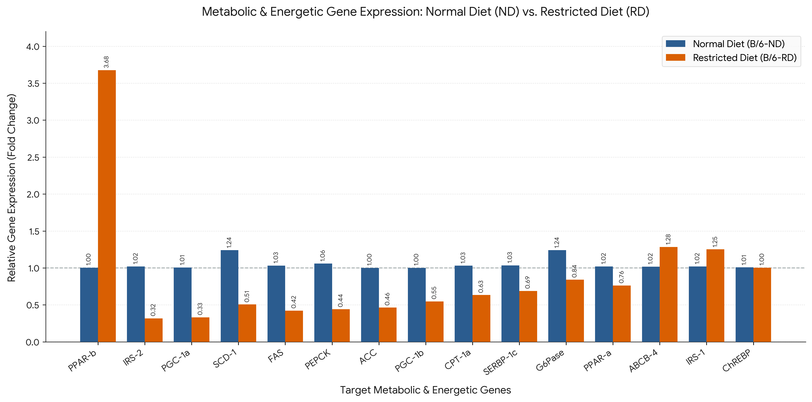
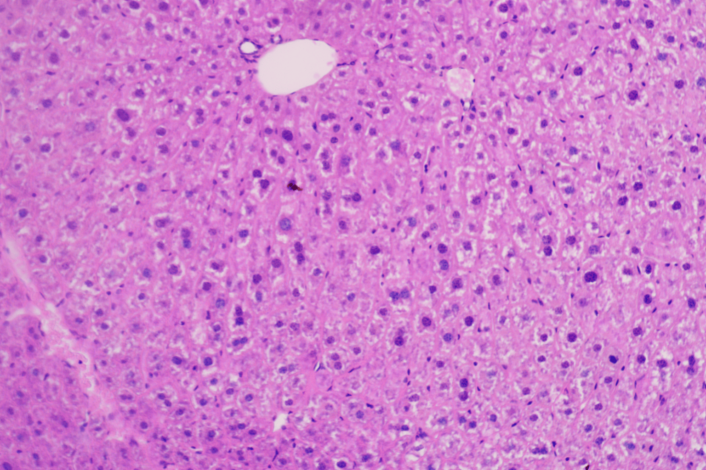
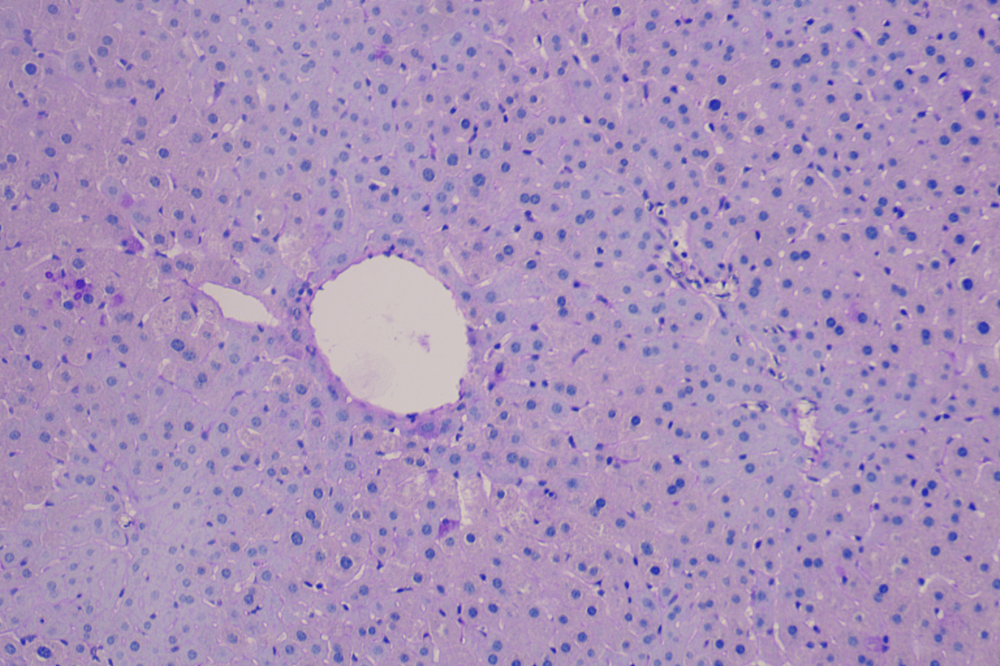
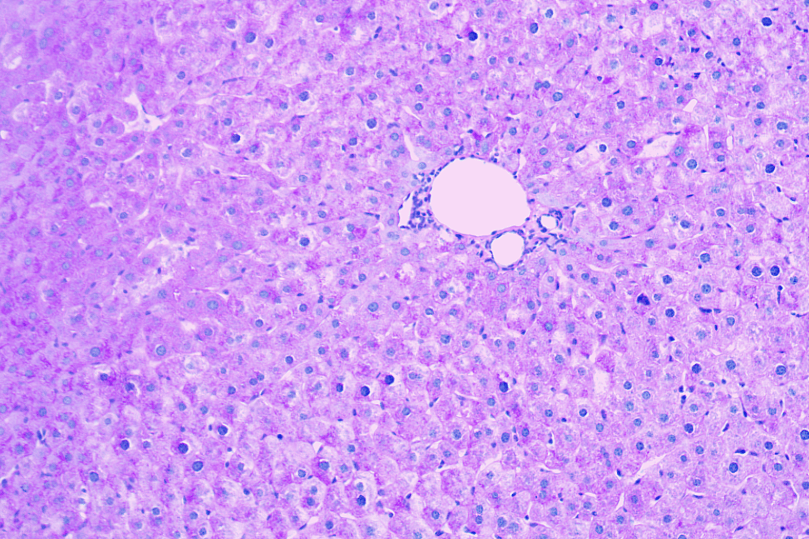

# Comparative Investigation of Hepatic and Colonic Responses to Prolonged Dietary Restriction in IL-10-Deficient and C57BL/6 Mice


## 📌 Project Overview

This research project investigates the physiological, metabolic, inflammatory, and histopathological responses to prolonged dietary restriction in two mouse models: C57BL/6 and interleukin-10-deficient (IL-10⁻/⁻) mice.

Dietary restriction alters nutrient availability and energy metabolism, whereas IL-10 deficiency compromises an important anti-inflammatory regulatory mechanism. Studying these conditions together provides an opportunity to understand how nutritional stress influences hepatic metabolism and tissue responses in animals with different inflammatory backgrounds.

The study primarily focuses on hepatic responses, with additional investigation of colonic tissue and the potential relationship between intestinal inflammation and liver metabolism through the gut–liver axis.

## 🎯 Aim of the Study

To comparatively investigate the effects of prolonged dietary restriction on metabolic regulation, inflammatory responses, and tissue architecture in C57BL/6 and IL-10-deficient mice.

## 🔬 Experimental Design

The study involved two mouse genotypes subjected to dietary restriction.

| Experimental parameter | Details |
|---|---|
| Animal models | C57BL/6 and IL-10⁻/⁻ mice |
| Sex | Male |
| Experimental duration | 60 days |
| Restricted food intake | 2 g/mouse/day |
| Diet | Altromin 1314, 5% fat |
| Animal facility | National Institute of Immunology (NII), New Delhi |
| Reference condition | Normal dietary condition (ND) |
| Intervention | Restricted dietary condition (RD) |

### Experimental Groups

1. C57BL/6 – Normal Diet (B/6 ND)
2. C57BL/6 – Restricted Diet (B/6 RD)
3. IL-10⁻/⁻ – Normal Diet (IL-10 ND)
4. IL-10⁻/⁻ – Restricted Diet (IL-10 RD)

## 🧪 Research Methodology

The experimental investigation combines physiological, biochemical, molecular, and histological approaches.

### 1. Physiological Assessment

- Monitoring food intake.
- Weekly body-weight measurements.
- Clinical observations.
- Survival monitoring.
- Terminal organ-weight measurements.

### 2. Serum Biochemical Analysis

Serum biochemical parameters were evaluated to investigate hepatic function and lipid metabolism.

| Parameter | Significance |
|---|---|
| SGOT / AST | Indicator associated with cellular and hepatocellular injury |
| SGPT / ALT | Indicator of hepatocellular injury |
| Total Cholesterol (CHO) | Evaluation of circulating lipid metabolism |
| Triglycerides (TG) | Assessment of circulating triglyceride levels |

Biochemical measurements were performed using commercial diagnostic kits and a Coralyzer clinical chemistry analyser.

### 3. Molecular Biology and Gene Expression

RNA isolation and cDNA synthesis were performed to investigate selected metabolic and inflammatory markers.

Techniques:
- Total RNA isolation using TRIzol.
- RNA quantification and purity assessment.
- cDNA synthesis.
- Real-time quantitative PCR (RT-qPCR).
- Relative gene expression analysis using the comparative Ct (2⁻ΔΔCt) method.

The molecular investigation focuses on genes associated with:
- Hepatic lipid metabolism.
- Glucose and energy regulation.
- Inflammatory signalling.
- Metabolic adaptation.

### 4. Histopathological Analysis

Liver and colon tissues were collected for histological examination.

**Hematoxylin and Eosin (H&E) staining**

Used to examine:
- General tissue architecture.
- Hepatocyte morphology.
- Nuclear and cytoplasmic appearance.
- Potential inflammatory-cell infiltration.
- Structural abnormalities.

**Periodic Acid–Schiff (PAS) staining**

Used to investigate:
- Carbohydrate-rich tissue components.
- Glycogen-associated staining in liver tissue.
- Mucin-containing goblet cells in intestinal tissue.

**Immunohistochemistry (IHC)**

The experimental methodology also includes immunohistochemical investigation of selected markers:

- CD68
- F4/80
- Caspase-3

These markers are relevant to macrophage-associated responses and apoptosis.

## 📊 Preliminary Research Findings

### 1. Body Weight Changes

Body weight measurements demonstrated different responses between normal-diet and restricted-diet animals.

| Experimental group | Initial weight | Final weight | Change |
|---|---:|---:|---:|
| IL-10 ND | 20.65 g | 23.27 g | +12.66% |
| B/6 ND | 22.68 g | 29.14 g | +28.43% |
| IL-10 RD | 20.86 g | 16.95 g | -18.72% |
| B/6 RD | 20.00 g | 18.82 g | -5.88% |

The restricted-diet groups showed a reduction in mean body weight, with a greater reduction observed in IL-10-deficient mice.

### 2. Serum Biochemical Profile

The following preliminary results were obtained from serum biochemical analysis (mean ± SD, n = 3).

| Parameter | B/6 ND | B/6 RD | IL-10 ND | IL-10 RD |
|---|---:|---:|---:|---:|
| SGOT (AST) | 39.27 | 46.96 | 63.58 | 95.47 |
| SGPT (ALT) | 48.34 | 38.46 | 37.52 | 45.73 |
| Total Cholesterol | 98.22 | 82.22 | 115.25 | 95.07 |
| Triglycerides | 87.78 | 78.38 | 306.40 | 130.49 |

*Note: Measurement units should be confirmed from the original laboratory records.*

**Preliminary observations:**
- Mean total cholesterol decreased under dietary restriction in both genotypes.
- Mean triglyceride concentrations also decreased in both genotypes.
- Mean SGOT increased in both restricted-diet groups.
- Mean SGPT decreased in B/6 mice but increased in IL-10-deficient mice.

These observations are descriptive. Statistical significance and biological interpretation require appropriate statistical analysis and correlation with other experimental findings.
### 3. Metabolic Markers 
## Gene Expression Analysis

<table>
  <tr>
    <td align="center">
      <b>Metabolic Marker Analysis in ND VS RD (B/6) </b><br>
      
    </td>
    <td align="center">
      <b>Metabolic Marker Analysis in ND VS RD (Il-10)</b><br>
      
    </td>
  </tr>
</table>
Compared to a Normal Diet (ND), a Restricted Diet (RD) triggers a major metabolic shift away from fat storage and toward energy conservation and fatty acid utilization, though the exact mechanism differs between mouse strains. In B6 mice, RD strongly induces PPAR-b to drive fatty acid oxidation while broadly suppressing fat synthesis (FAS, SCD-1, ACC), glucose production (PEPCK), and mitochondrial biogenesis (PGC-1a/b) to conserve cellular energy. In IL-10 mice (18sRNA), RD similarly shuts down terminal fat synthesis (FAS, SCD-1) and glucose release (G6Pase), but instead boosts mitochondrial fatty acid transport (CPT-1a, PPAR-a), mitochondrial coactivators (PGC-1a/b), and insulin signaling (IRS-1). Together, both strains adapt to caloric restriction by halting lipid accumulation and lowering glucose output, with B6 favoring energy-sparing adaptation and IL-10 relying on heightened mitochondrial lipid oxidation


### 3. Liver Histology
### Liver Histopathological Analysis

H&E and PAS staining were performed to examine liver tissue architecture, cellular morphology, and carbohydrate-associated staining patterns in C57BL/6 and IL-10-deficient mice under normal and restricted dietary conditions.

#### 1. C57BL/6 Mice

| H&E Staining | PAS Staining |
|---|---|
| **Normal Diet (B/6-ND)** | **Normal Diet (B/6-ND)** |
|  |  |
| **Restricted Diet (B/6-RD)** | **Restricted Diet (B/6-RD)** |
|  |  |

#### 2. IL-10-Deficient Mice

| H&E Staining | PAS Staining |
|---|---|
| **Normal Diet (IL-10-ND)** | **Normal Diet (IL-10-ND)** |
|  |  |
| **Restricted Diet (IL-10-RD)** | **Restricted Diet (IL-10-RD)** |
|  |  |

B/6 Strain (ND vs. RD): On H&E, switching from ND to RD causes clear hepatocyte shrinkage and loss of cytoplasmic clearing, shifting the cells to a compact, deeply eosinophilic state. The corresponding B/6-RD PAS stains confirm near-complete glycogen depletion, which aligns with your gene expression profile showing suppressed gluconeogenesis (PEPCK 0.44, G6Pase 0.84), suppressed lipogenesis (FAS 0.422, SCD-1 0.506), and elevated fatty acid oxidation (PPAR-b 3.676)

IL-10 Strain (ND vs. RD): Under ND, IL-10 livers exhibit pronounced hepatocyte ballooning/clearing on H&E paired with intense, diffuse magenta positivity on PAS, indicative of heavy baseline glycogen accumulation. Under RD, PAS staining visibly decreases in intensity (consistent with the strong suppression of G6Pase to 0.15 in your 18sRNA dataset), yet H&E still shows prominent reticulated cytoplasmic clearing. (Note: A B/6-ND PAS image was not included in this set; adding it would provide a direct baseline comparison for B/6 glycogen depletion.)


## 🧬 Scientific Significance

This research explores the interaction between nutritional restriction and impaired anti-inflammatory regulation.

The comparison between C57BL/6 and IL-10-deficient mice provides a framework for investigating:

- Nutritional stress and hepatic metabolic adaptation.
- The relationship between IL-10 deficiency and inflammatory regulation.
- Changes in circulating lipid-associated parameters.
- Hepatic tissue architecture under prolonged dietary restriction.
- Potential interactions between intestinal inflammation and hepatic responses.

## 🛠️ Techniques and Skills

**Experimental Biology**
- Laboratory animal research.
- Tissue collection and processing.
- Serum separation.
- Biochemical analysis.

**Molecular Biology**
- RNA extraction.
- cDNA synthesis.
- RT-qPCR.
- Gene expression analysis.

**Histology**
- Paraffin embedding.
- Microtome sectioning.
- H&E staining.
- PAS staining.
- Immunohistochemistry.

**Data Analysis and Scientific Communication**
- Experimental data organization.
- Body-weight growth curves.
- Biochemical data visualization.
- Comparative interpretation.
- Scientific literature review.
- Research documentation.

## 📁 Suggested Repository Structure

```text
Dietary-Restriction-IL10-Mouse-Study/
│
├── README.md
│
├── Documentation/
│   ├── Research_Abstract.pdf
│   ├── Experimental_Design.pdf
│   └── Methodology.pdf
│
├── Data/
│   ├── Body_Weight/
│   ├── Serum_Biochemistry/
│   └── Gene_Expression/
│
├── Figures/
│   ├── Growth_Curves/
│   ├── SGOT/
│   ├── SGPT/
│   ├── Cholesterol/
│   ├── Triglycerides/
│   └── Overall_Biochemical_Profile/
│
├── Histology/
│   ├── H_and_E/
│   │   ├── B6_ND/
│   │   ├── B6_RD/
│   │   ├── IL10_ND/
│   │   └── IL10_RD/
│   │
│   └── PAS/
│       ├── B6_ND/
│       ├── B6_RD/
│       ├── IL10_ND/
│       └── IL10_RD/
│
└── References/
    └── References.bib
```

## 🏛️ Research Institution

**National Institute of Immunology (NII)**  
New Delhi, India

Animal experimentation was conducted at the NII Small Animal Facility under Institutional Animal Ethics Committee (IAEC) approval.

IAEC Approval Reference: `IAEC/DS/2024/230`

## ⚠️ Research Notes

- The reported sample size varies across analyses; consult the corresponding experimental records and figure legends.
- Some molecular and histological analyses may require additional data and validation.
- Preliminary observations should not be interpreted as statistically established conclusions.
- No unsupported causal conclusions are drawn from the available results.

## 👨‍🔬 Project Information

**Academic Programme:** Bachelor of Technology (B.Tech) in Bioengineering  
**University:** VIT Bhopal University  
**Research Domain:** Bioengineering | Immunology | Metabolism | Molecular Biology | Histopathology

---

*This repository documents an academic research project investigating the interaction between prolonged dietary restriction, hepatic metabolism, and inflammatory regulation in experimental mouse models.*
